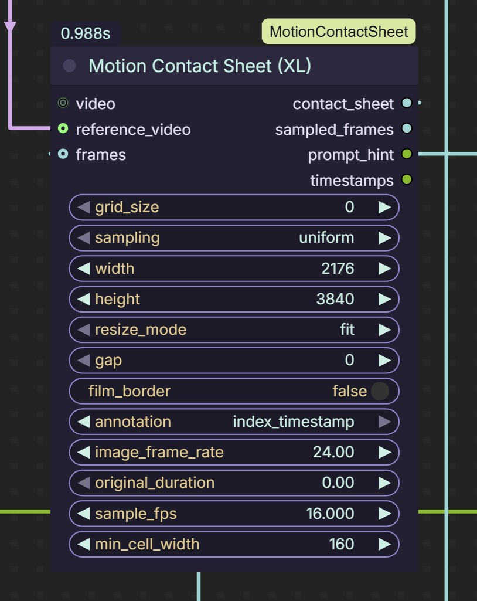

# ComfyUI-MotionContactSheet

Standalone **Motion Contact Sheet (XL)** node, extracted from `comfyui-svdint4`
(Turing Utils) with two changes:

1. **Grid size up to 32 x 32** (1024 panels) instead of 8 x 8.
2. **Timestamps pinned to the original clip** via `original_duration`, so
   changing the frame rate / interpolating no longer stretches the labels.

Category: `video/contact sheet`. Install by copying this folder into
`ComfyUI/custom_nodes/` and restarting ComfyUI. No extra dependencies
(uses torch, Pillow, PyAV and `comfy_api`, all bundled with ComfyUI).




## New / changed inputs

| Input | Meaning |
| --- | --- |
| `grid_size` | 1-32 = fixed N x N sheet. **0 = auto** (see `sample_fps`). |
| `sample_fps` | Auto mode only. Panels per second of the ORIGINAL video: panels = duration x sample_fps. A 5 s clip at 8 gives 40 panels, laid out as 8 x 5. The layout is the squarest grid that fits (exact fit when possible, otherwise it rounds up, e.g. 41 -> 7 x 6 = 42), capped at 32 x 32 and at the number of frames. |
| `original_duration` | Length in seconds of the original clip. `> 0` pins the timestamps to it (frame i of N is labelled `i * duration / N`) regardless of `image_frame_rate`, frame-rate changes or interpolation. `0` => use `reference_video` if connected, otherwise the clip's own duration. |
| `reference_video` | Optional ORIGINAL video. If `original_duration` is 0 its duration drives the auto layout and the timestamps. Connect it when the frames were re-timed/interpolated. |
| `image_frame_rate` | Playback rate of an IMAGE batch; only used to get its duration when neither `original_duration` nor `reference_video` is set. |
| `min_cell_width` | Only when `width = height = 0`: enlarges the sheet so each panel is at least this wide (default 160) so big grids stay readable. `0` = keep source resolution. |
| `width` / `height` | Max raised to 16384, no step snapping. |

New 4th output `timestamps`: the grid and duration used, then one line per panel (`01: frame 0 @ 0.00s`).

Everything else (sampling modes, film border, annotation, resize modes, gap,
prompt hint) is unchanged. Node id is `MotionContactSheetXL`, so it will not
clash with the original `TuringUtilsVideoMotionContactSheet` if both are installed.

## Notes

- Very large grids need big cells to stay legible; if you set an explicit
  width/height that makes cells smaller than 8 px you get a clear error.
- Duration = frame count / original fps, e.g. 81 frames @ 16 fps = 5.06 s.

## Install

```
cd ComfyUI/custom_nodes
git clone https://github.com/YOUR_USERNAME/ComfyUI-MotionContactSheet
```
Restart ComfyUI. Run the tests with `python tests/test_core.py` (needs torch, Pillow, PyAV).

## Credits and license

Derived from the Video Motion Contact Sheet node in
[wjie98/comfyui-svdint4](https://github.com/wjie98/comfyui-svdint4). Apache-2.0, see `LICENSE` and `NOTICE`.
